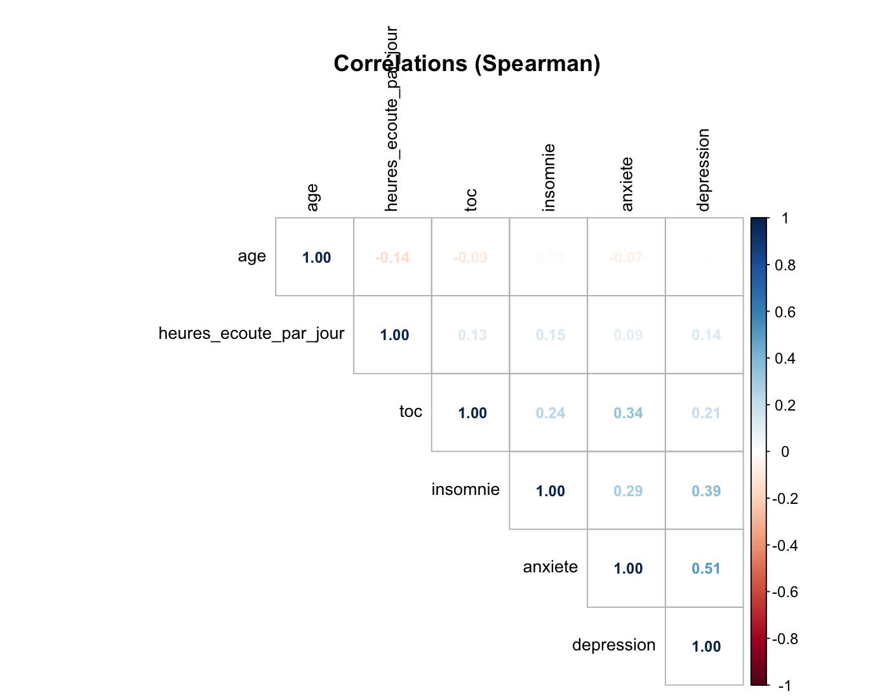
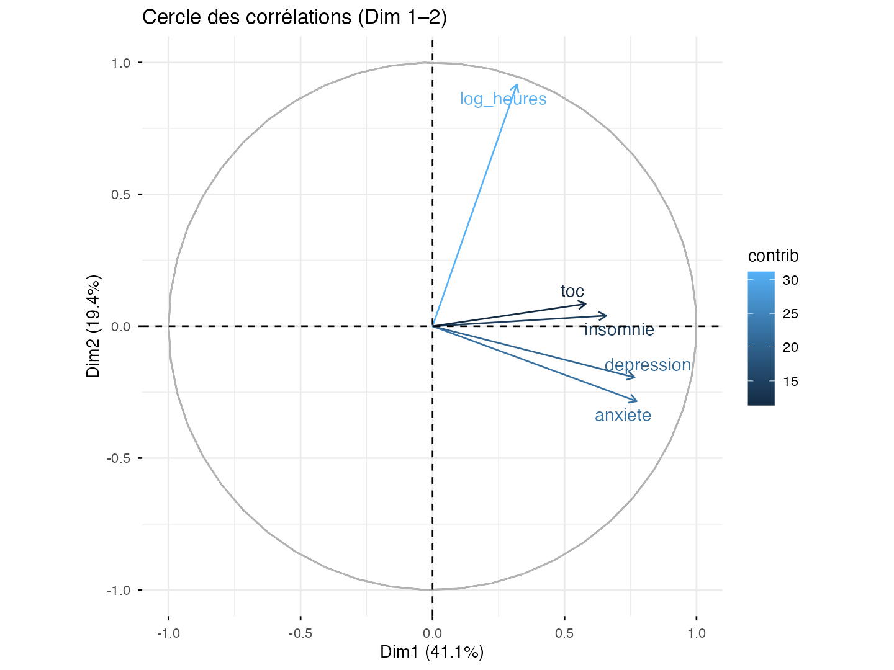
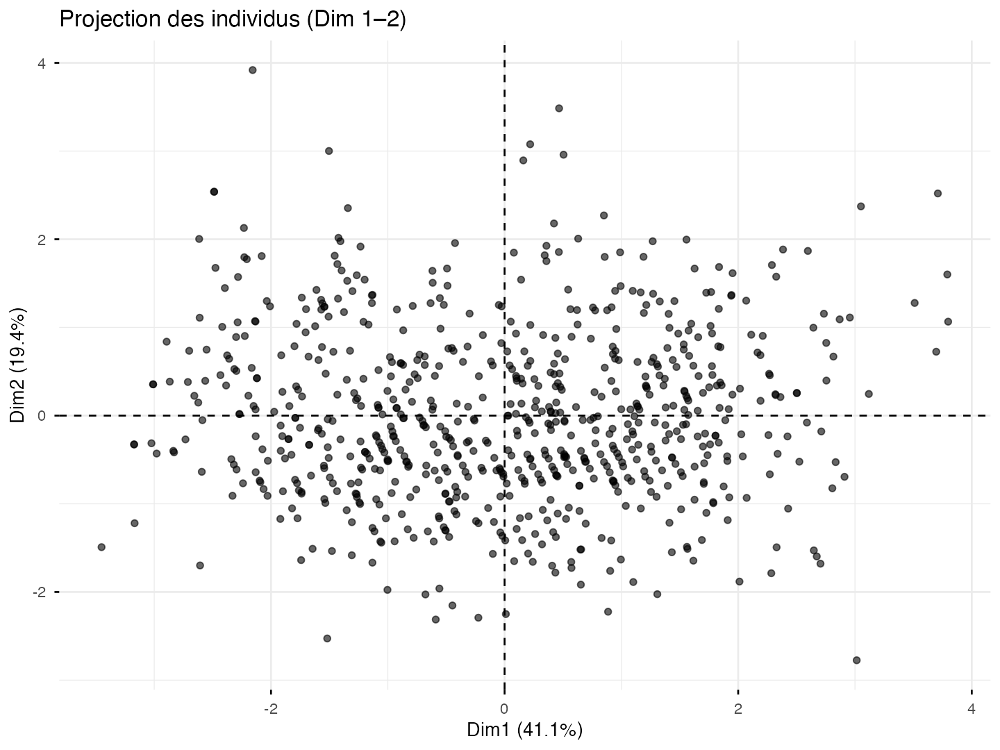

# Analyse descriptive — Préférences musicales et bien-être psychologique

Projet réalisé dans le cadre du Master 1 Économétrie Appliquée à l'IAE Nantes, pour le cours d'Analyse descriptive des données.

## Objectif

Étudier les liens entre les habitudes d'écoute musicale et différents indicateurs de bien-être psychologique : anxiété, dépression, insomnie et troubles obsessionnels compulsifs (TOC).

L'analyse cherche notamment à déterminer si le genre musical préféré, la durée d'écoute quotidienne ou l'écoute de musique en travaillant sont associés à des différences dans les scores psychologiques.

## Données

Les données proviennent de l'enquête **Music & Mental Health Survey**, disponible sur [Kaggle](https://www.kaggle.com/datasets/catherinerasgaitis/mxmh-survey-results).

- 736 observations issues d'une enquête en ligne.
- Variables relatives aux pratiques musicales et aux indicateurs de santé mentale auto-déclarés.
- Traitement des valeurs manquantes par imputation multiple (MICE).

## Méthodologie

L'analyse a été réalisée sous **R** et comprend :

- **Préparation des données :** nettoyage, traitement des valeurs manquantes et transformations.
- **Analyse univariée :** statistiques descriptives et étude des distributions.
- **Analyse bivariée :** corrélations de Pearson et Spearman, tests du Khi-deux et tests de Student.
- **Analyse multivariée :** analyse en composantes principales (ACP), réduction de dimension et interprétation des axes factoriels.

## Principaux résultats

- Les indicateurs d'anxiété, de dépression, d'insomnie et de TOC présentent des corrélations positives.
- Les associations entre la durée d'écoute musicale et les indicateurs psychologiques restent globalement faibles.
- L'écoute de musique en travaillant est associée à une perception plus positive de ses effets.
- L'ACP distingue principalement deux dimensions : les indicateurs de santé mentale et l'intensité d'écoute musicale.

Ces résultats sont exploratoires et **ne permettent pas d'établir de relation causale** entre les pratiques musicales et la santé mentale.

## Visualisations

### Matrice de corrélation de Spearman



### Cercle des corrélations — ACP



### Projection des individus — ACP



## Structure du dépôt

```text
analyse-descriptive-musique-bien-etre/
├── README.md
├── code/
│   ├── analyse_musique_bien_etre.qmd
│   └── preparation_donnees.R
├── data/
│   ├── raw/
│   │   └── base.csv
│   └── processed/
│       └── base_n.csv
├── figures/
│   ├── matrice_correlations.png
│   ├── cercle_correlations_acp.png
│   └── projection_individus_acp.png
└── rapport/
    └── rapport.pdf
```

## Reproduire l'analyse

Depuis la racine du projet, ouvrir le fichier `.Rproj` dans RStudio, puis exécuter :

```r
source("code/preparation_donnees.R")
```

Ouvrir ensuite `code/analyse_musique_bien_etre.qmd` et cliquer sur **Render** pour générer le rapport.

Les bibliothèques R utilisées doivent être installées au préalable.

## Rapport

[Consulter le rapport complet (PDF)](rapport/rapport.pdf)

## Auteur

**Amélie Pires**

Master 1 Économétrie Appliquée — Analyse de données et descriptive - IAE Nantes, 2025-2026.

## Contact

**Amélie Pires**

[Mail : amelie.pires@hotmail.com](mailto:amelie.pires@hotmail.com) · [LinkedIn](https://www.linkedin.com/in/amelie-pires) · [GitHub](https://github.com/aps-18)
